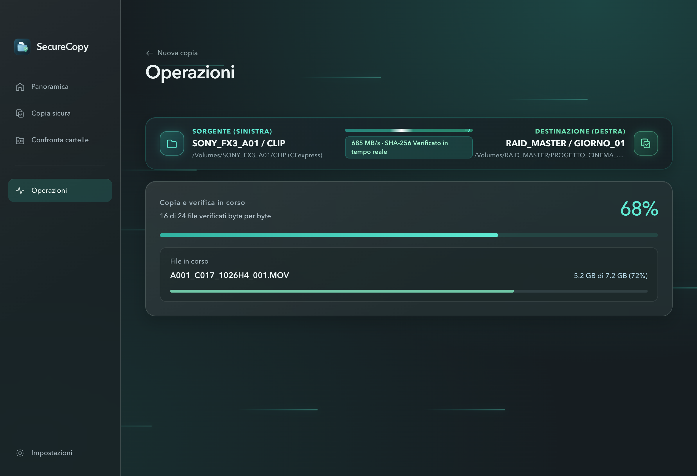
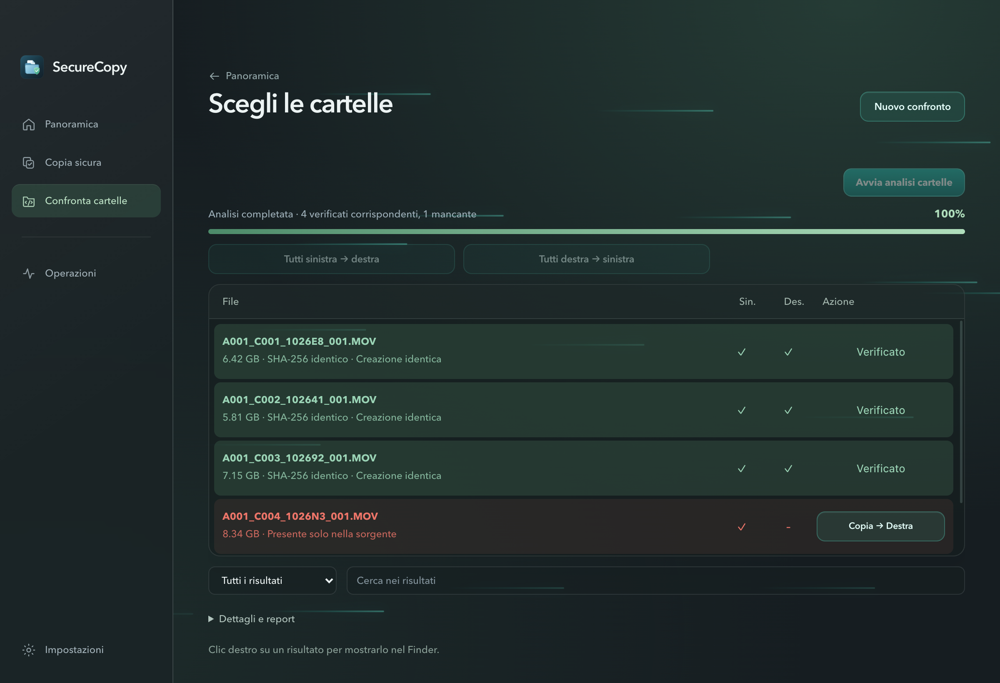
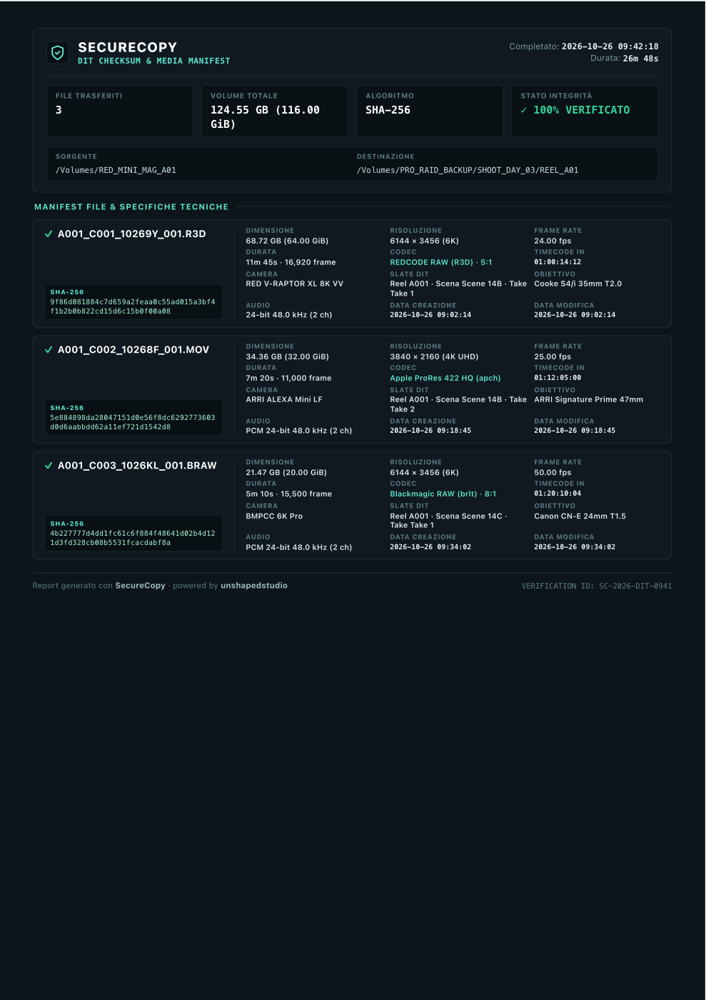

# SecureCopy
> Copia sicura e verifica file per macOS.  
> powered by **unshapedstudio**

---

### ⬇️ Scarica l'applicazione

- 🍏 **[Scarica per Mac Apple Silicon (M1 / M2 / M3 / M4)](https://github.com/marcovernetto-lgtm/SecureCopy/releases/latest)** (`.dmg`)
- 💻 **[Scarica per Mac Intel](https://github.com/marcovernetto-lgtm/SecureCopy/releases/latest)** (`.dmg`)

*(Compatibile con macOS 13 Ventura o successivo. Apri il file scaricato e trascina SecureCopy in Applicazioni).*

---

### Cosa fa

- 🎬 **Scarica schede e file in sicurezza**: ideale per videomaker, fotografi e creator per trasferire riprese e foto su uno o più dischi senza rischi di corruzione.
- 🛡️ **Controllo di integrità al 100%**: verifica bit per bit di ogni file per darti la certezza assoluta prima di formattare le schede.
- 📄 **Report PDF completo (DIT)**: genera con un clic un documento con l'elenco di tutti i file copiati, le specifiche tecniche (camera, codec, risoluzione, durata) e la certificazione crittografica.
- 🔍 **Confronta cartelle**: controlla in un secondo se due cartelle o hard disk hanno gli stessi file o cosa manca.

---

### Interfaccia

---

### Report PDF di verifica (DIT)

---

powered by **unshapedstudio**
