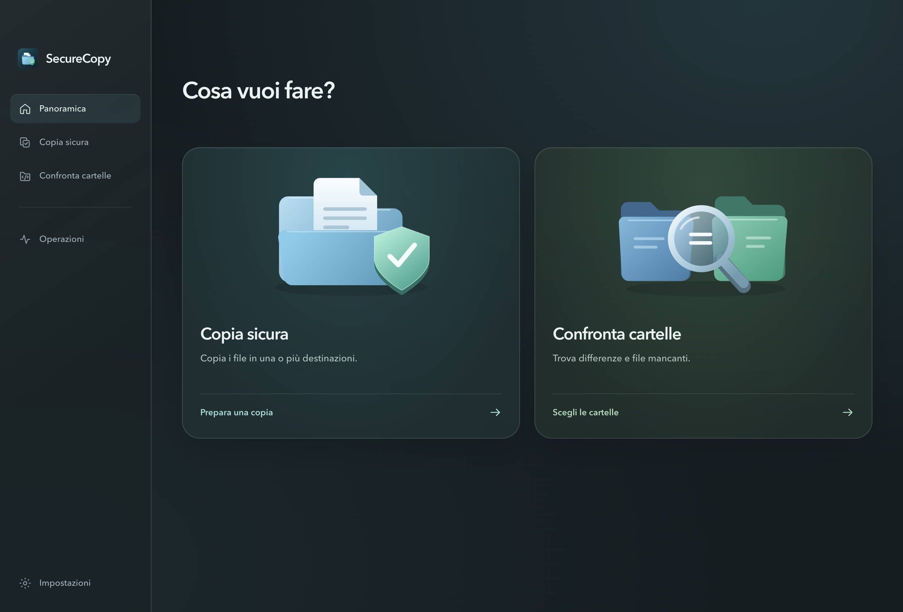
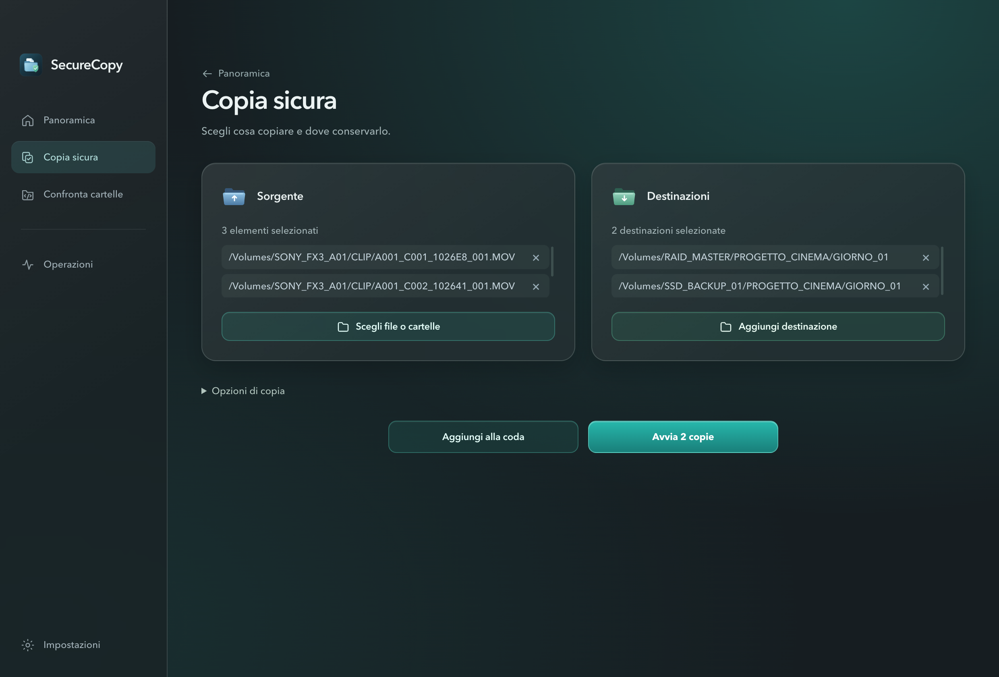
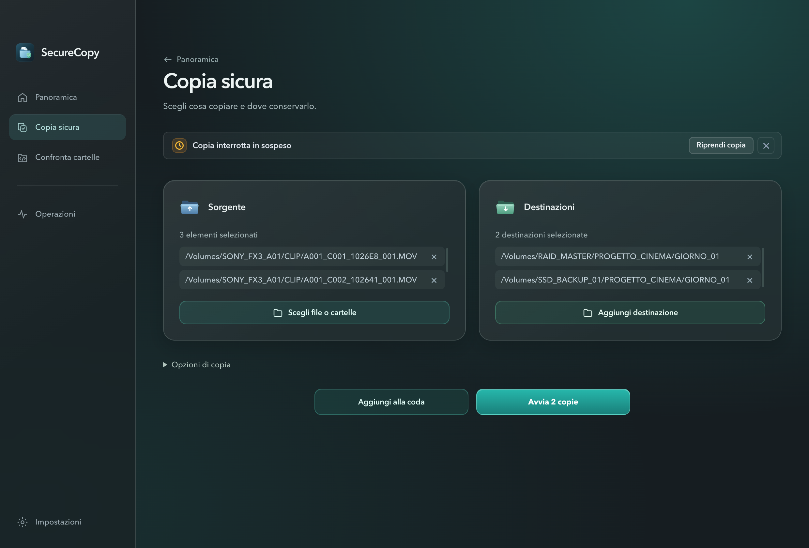
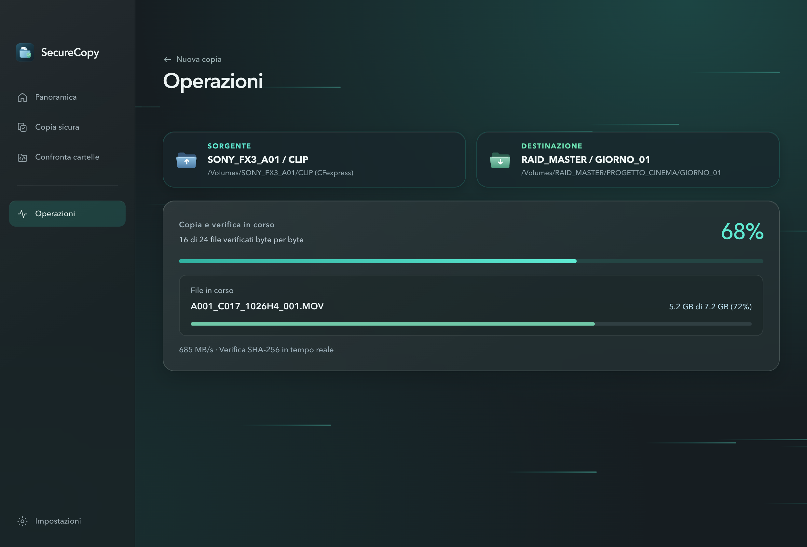
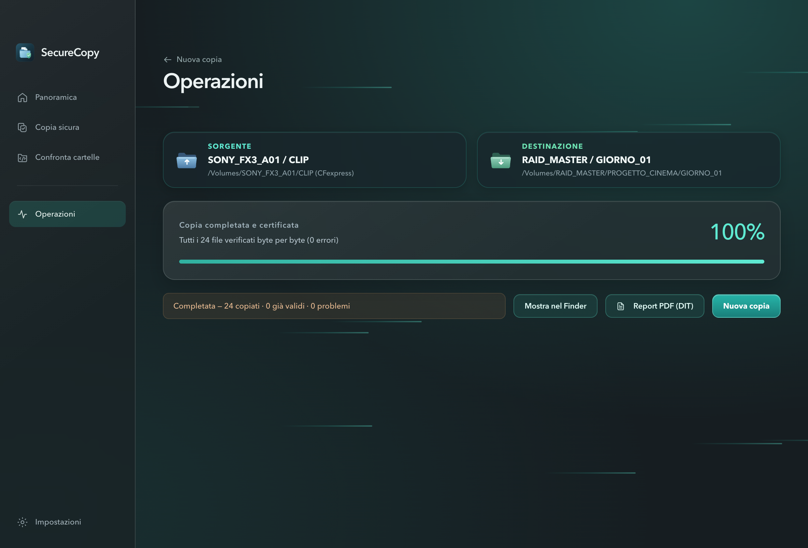
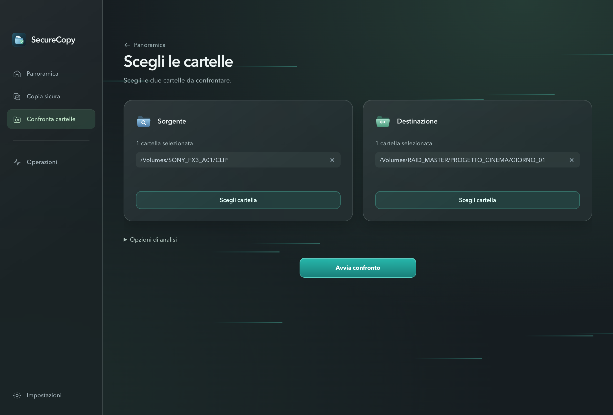
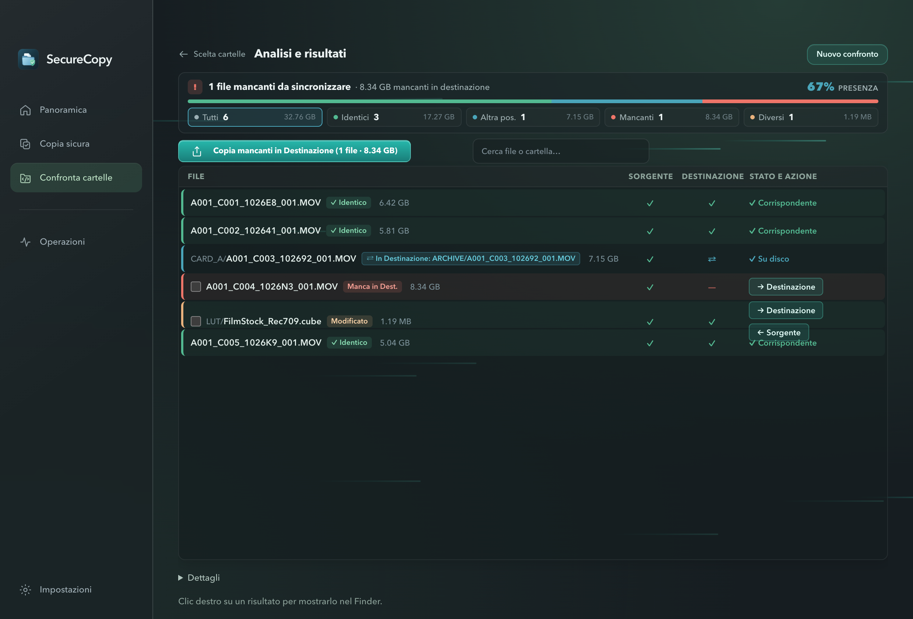
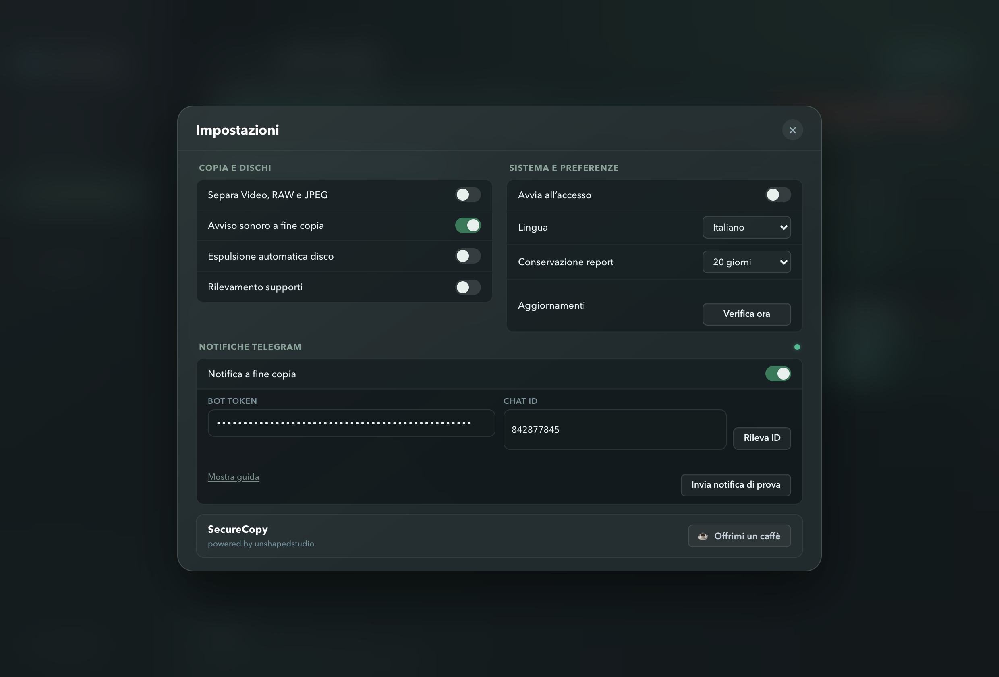
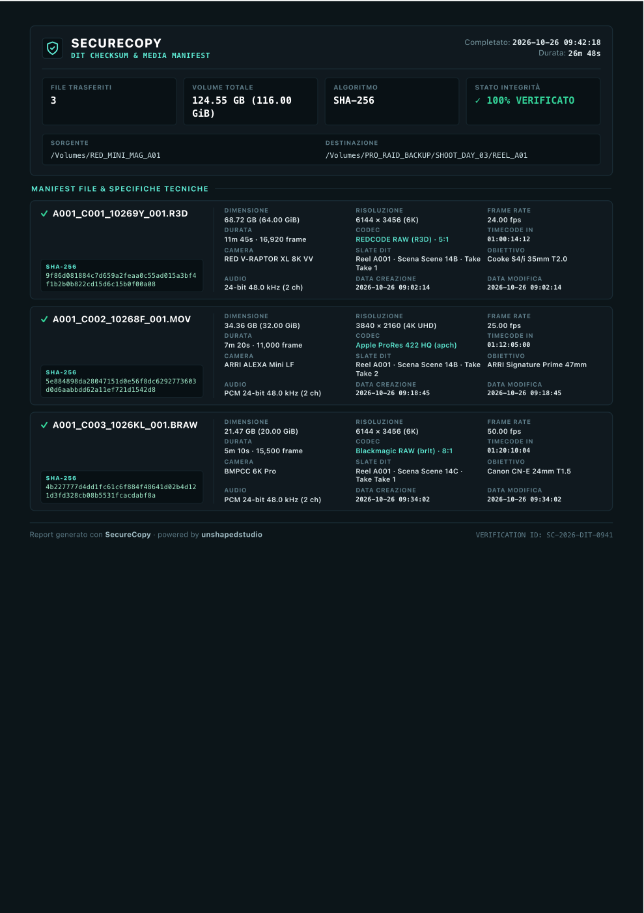

# 🎬 Presentazione SecureCopy: La Guida Facile per Tutti
> **La certezza di non perdere mai un file, spiegata semplice.**  
> *Una guida pensata per chiunque, dai professionisti del video a chi vuole solo salvare le foto delle vacanze senza paure.*

---

## 🧐 Il problema che tutti abbiamo vissuto

Ti è mai capitato di copiare una cartella pesante o le riprese di una giornata, vedere la barra del Mac arrivare al 100%, togliere la chiavetta o formattare la scheda di memoria e... scoprire che **un video era corrotto o mancavano dei file**?

Il normale "Copia e Incolla" del computer (il Finder) fa un lavoro semplice e frettoloso: trasferisce i file, ma **non controlla se quello che ha scritto è davvero identico all'originale**. Se il disco fa un piccolo scatto, se c'è un calo di corrente o se il cavo fa falso contatto, il file rischia di rompersi per sempre.

---

## 🛡️ La Soluzione: Cos'è SecureCopy?

**SecureCopy** è un'applicazione per Mac nata per risolvere questo problema una volta per tutte, rendendo una tecnologia professionale accessibile e intuitiva per chiunque.

Ecco cosa fa per te:

1. **Fa la "Copia e Ricontrollo" (Verifica SHA-256):**  
   Non si limita a copiare: legge ogni singolo byte dell'originale e della copia e confronta la loro "impronta digitale" (chiamata checksum). Se sono identici al 100%, li certifica. Se qualcosa non va, ti avvisa subito.
2. **Copia su più dischi contemporaneamente:**  
   Basta un clic per salvare la stessa scheda SD contemporaneamente sull'Hard Disk di lavoro e sul Disco di Backup. Due copie al prezzo di una, nello stesso tempo.
3. **Se qualcosa si interrompe, riparti da dove eri:**  
   Si scarica la batteria? Togli per sbaglio la scheda? SecureCopy si ricorda cosa ha già copiato e ti permette di riprendere con un clic, oppure di cancellare la copia interrotta con una comoda **`×`**.
4. **Ti manda un messaggio su Telegram:**  
   Devi copiare 200 GB e non vuoi restare fermo a fissare lo schermo? SecureCopy ti invia una notifica sul tuo smartphone appena ha finito.
5. **Ti rilascia un Certificato PDF (Report DIT):**  
   Un documento elegante e ordinato con l'elenco dei file, le date, i formati e la certificazione crittografica.

---

## 📸 Come si usa: Il percorso passo-passo

### 1. La Schermata Principale
Appena apri l'app trovi un'interfaccia pulita, moderna e senza fronzoli. Scegli se fare una **Copia sicura** o **Confrontare due cartelle**.

---

### 2. Scegli cosa copiare e dove salvarlo
- Clicca su **Scegli file o cartelle** a sinistra per selezionare la scheda o i documenti da copiare.
- Clicca su **Aggiungi destinazione** a destra per selezionare uno o più hard disk.
- Premi **Avvia copia**.

---

### 3. Ripresa o cancellazione rapida (Nuova funzione)
Se una copia precedente è stata interrotta, in alto compare un banner:
- Puoi cliccare **Riprendi copia** per finire il lavoro.
- Oppure clicchi la **`×`** per scartarla definitivamente se non ti serve più.

---

### 4. Monitoraggio live e trasparente
Vedi in tempo reale la velocità (fino a oltre 680 MB/s), il nome del file in lavorazione e la percentuale esatta.

---

### 5. Tutto fatto!
Quando ha finito, l'app suona un gradevole avviso e ti mostra l'esito verde: *"0 problemi"*. Puoi aprire la cartella nel Finder o stampare il Report PDF con un solo click.

---

### 6. Confronta due cartelle (Cosa manca?)
Hai due hard disk pieni di foto o progetti e non sai quale sia quello più aggiornato?  
Scegli le due cartelle e premi **Avvia confronto**. Puoi togliere o cambiare cartella facilmente con la comoda `×` accanto a ogni percorso.

---

### 7. Risultati del confronto a colpo d'occhio
In pochi secondi vedi:
- **Identici (Verde):** sono già perfettamente uguali.
- **Altra posizione (Azzurro):** il file esiste già nell'altro disco, ma in una cartella diversa (l'app lo riconosce ed evita di duplicarlo!).
- **Mancanti (Rosso/Arancione):** ciò che manca. Puoi copiare i file mancanti con un clic direttamente dalla tabella!

---

### 8. Impostazioni semplici e Bot Telegram
Dall'ingranaggio in basso puoi configurare le notifiche Telegram, impostare per quanti giorni tenere i report (da 2 a 30 giorni) e attivare la divisione automatica di foto e video.

---

### 9. Il Report Professionale DIT in PDF
Un documento completo pronto da inviare al cliente, alla produzione o da archiviare per sicurezza.

---

## 🎯 A chi serve SecureCopy?

- 🎥 **Videomaker, registi e DIT:** per scaricare schede CFexpress/SD dai set senza il terrore di perdere take o corrompere file RAW.
- 📸 **Fotografi di eventi e matrimoni:** per fare la doppia copia immediata al ritorno a casa e certificare il lavoro.
- 💻 **Studi e Liberi Professionisti:** per spostare archivi e progetti importanti tra hard disk e server di rete senza dubbi.
- 👨‍👩‍👧‍👦 **Famiglie e Appassionati:** per salvare le foto e i video di famiglia su disco esterno con la certezza che durino negli anni.

---
*powered by **unshapedstudio***
